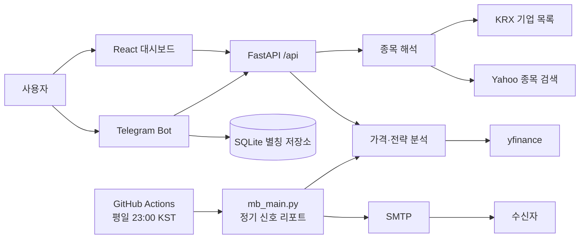

# MB Quant

국내·미국 주식의 이름 또는 티커를 입력하면 가격 정보와 Maxwell–Boltzmann(MB) 분포 기반 참고 신호를 웹 대시보드와 Telegram Bot으로 제공하는 금융 데이터 서비스입니다.

> 교육·연구 목적의 사이드 프로젝트입니다. 분석 결과는 투자 권유가 아니며, 실제 투자 판단에는 사용할 수 없습니다.

## 라이브 대시보드

[gilgop.cloud](https://gilgop.cloud)에서 배포된 대시보드를 사용할 수 있습니다.

## 문제와 해결

금융 데이터 조회는 티커 형식, 시장 구분, 조회 채널이 서로 달라 처음 사용하는 사람이 접근하기 어렵습니다. MB Quant는 이 문제를 다음과 같이 해결합니다.

- `삼성전자`, `삼전`, `AAPL`, `005930.KS`처럼 다양한 입력을 하나의 종목으로 해석합니다.
- 분석 결과를 차트와 성과 지표로 웹에서 보여주고, 자주 쓰는 조회는 Telegram 명령으로도 제공합니다.
- 종가 기준 신호를 다음 거래 구간에 적용해 백테스트의 시점 오류를 줄이고, 외부 데이터 조회에는 재시도와 오류 처리를 적용합니다.

## 핵심 기능

- 한글 종목명·별칭·국내외 티커 통합 검색 및 해석
- 최근 가격, 등락률, 시가·고가·저가 조회
- MB 분포 기반 매수·매도·보유·숏 상태와 전략/시장 누적 수익률 비교
- 가격·전략 성과·신호를 보여주는 React 대시보드
- Telegram Bot의 `/price`, `/signal`, 종목 별칭 등록·조회·삭제
- GitHub Actions 기반 평일 23:00 KST 정기 신호 이메일 리포트
- Docker, 헬스체크, Caddy/Nginx 배포 구성
- API·전략·종목 해석 테스트와 GitHub Actions 품질 검사

## 기술 구성

| 영역 | 사용 기술 | 선택 이유 |
| --- | --- | --- |
| Frontend | React, Vite, Plotly, Axios | 검색·차트 중심의 단일 페이지 대시보드 구성 |
| Backend | FastAPI, Pydantic, Uvicorn | 비동기 API와 명확한 응답 스키마 제공 |
| Data | yfinance, KRX 기업 목록, Yahoo Finance Search | 국내외 종목명·티커 해석과 가격 데이터 확보 |
| Analysis | Pandas, NumPy, SciPy | 시계열 전처리와 MB 분포 기반 신호 계산 |
| Bot | python-telegram-bot, SQLite | 채팅별 별칭을 보존하는 빠른 조회 채널 |
| Report | GitHub Actions, SMTP | 평일 배치 실행으로 종목별 신호·포지션·성과 요약 전달 |
| Delivery | Docker, GitHub Actions, Caddy/Nginx | 재현 가능한 빌드·상태 점검·배포 |

## 시스템 흐름



## 빠른 시작

사전 요구 사항: Python 3.11+, Node.js 22.12+, npm

```bash
python3 -m venv .venv
. .venv/bin/activate
pip install -r requirements-dev.txt

cd frontend
npm ci
cd ..
```

터미널을 두 개 열어 실행합니다.

```bash
# API
.venv/bin/uvicorn backend.main:app --reload

# Frontend
cd frontend && npm run dev
```

개발 서버는 기본적으로 `http://localhost:5173`에서 열립니다. API 문서는 `http://127.0.0.1:8000/docs`에서 확인할 수 있습니다.

## 검증

```bash
.venv/bin/python -m pytest -q
cd frontend && npm run lint && npm run build
```

Pull Request에서는 GitHub Actions가 백엔드 테스트와 프론트엔드 린트·빌드를 자동으로 실행합니다.

## 문서

- [전략과 검증 범위](docs/strategy.md)
- [아키텍처와 설계 판단](docs/architecture.md)
- [API 사용법](docs/api.md)
- [배포와 환경 변수](docs/deployment.md)
- [포트폴리오·면접용 정리](docs/portfolio.md)

## 프로젝트 구조

```text
backend/              FastAPI, 종목 해석, 가격·전략 서비스
frontend/             React 대시보드와 Plotly 차트
telegram_bot/         Telegram 명령과 채팅별 별칭 저장
module/               SMTP 이메일 전송 모듈
deploy/               Docker, systemd, Caddy/Nginx 구성
tests/                전략·종목 해석·API 테스트
docs/                 포트폴리오 및 운영 문서
```

## 한계와 다음 개선 방향

- yfinance 및 공개 종목 검색 데이터는 지연·누락·제공 정책 변경 가능성이 있습니다.
- 거래비용, 세금, 슬리피지, 공매도 가능 여부와 장중 체결·갭 리스크를 백테스트에 반영하지 않았습니다.
- 현재는 단일 종목 분석에 초점을 둡니다. 향후 데이터 품질 모니터링, 결과 캐시, 전략별 비교 실험을 추가할 수 있습니다.

상세한 전략 가정과 해석 시 주의점은 [전략 문서](docs/strategy.md)에 기록했습니다.
