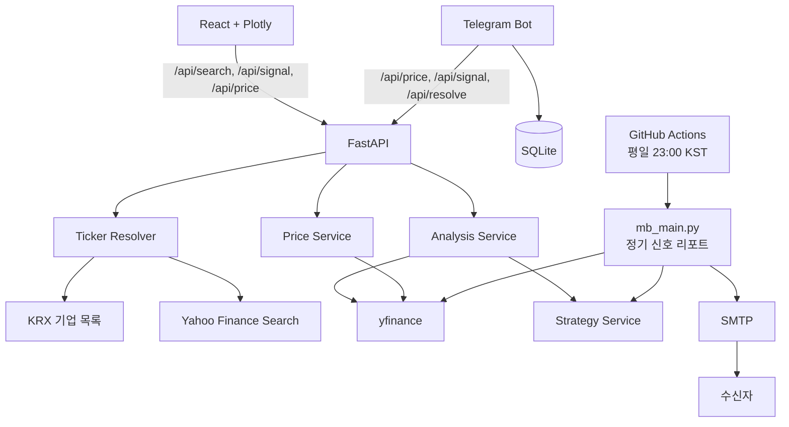
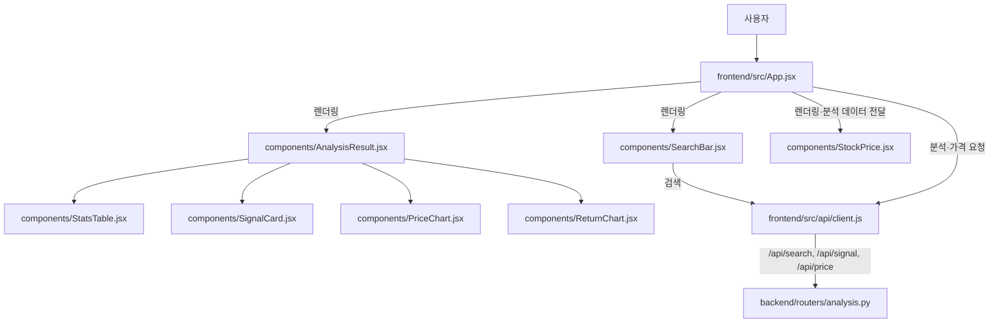
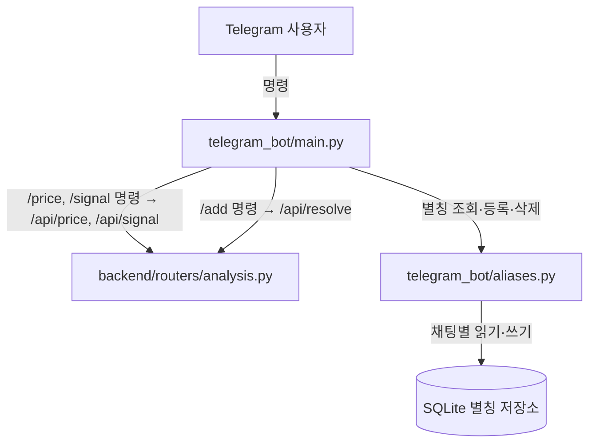
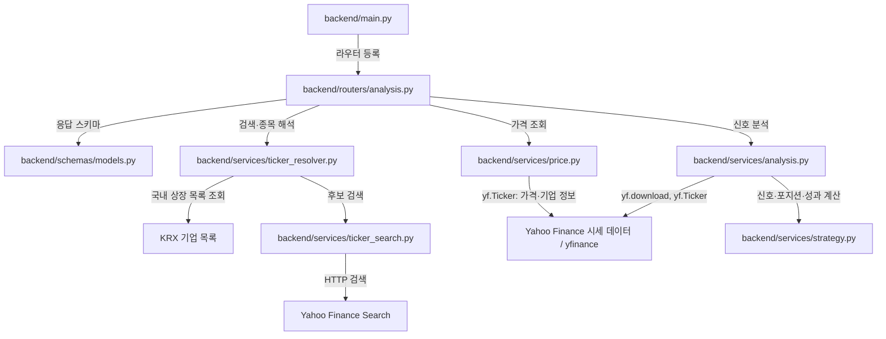
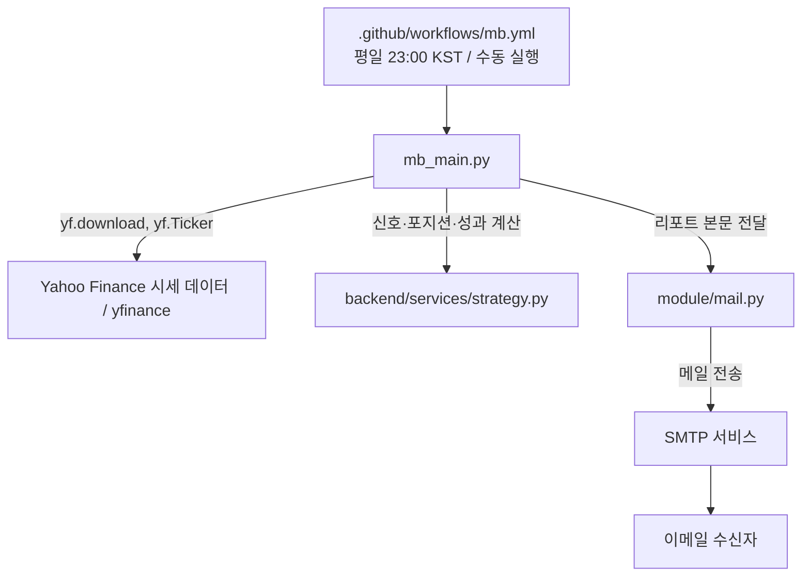

# 아키텍처와 설계 판단

## 구성

## 상세 아키텍처

웹 대시보드, Telegram Bot, API·분석 서비스, 정기 이메일 리포트의 컴포넌트와 파일별 연결 관계입니다. 화살표는 호출·렌더링·외부 데이터 조회의 방향을 나타냅니다. 파일 경로는 저장소 루트 기준입니다.

큰 PNG를 페이지마다 디코딩하지 않도록 Mermaid로 표시합니다. [기존 PNG 원본](images/architecture.png)은 참고용으로 보존하며, 원본에서 누락된 의존성은 아래 다이어그램과 텍스트 설명에 반영했습니다.

### 웹 대시보드

`components/`는 `frontend/src/components/`를 뜻합니다. `App.jsx`는 검색 결과 선택 시 API 클라이언트로 분석과 가격을 요청하고 결과를 각 뷰에 전달합니다. `AnalysisResult.jsx`는 통계 표, 신호 카드, 가격 차트, 수익률 차트를 렌더링합니다. `StockPrice.jsx`는 가격과 분석 데이터를 함께 사용해 가격·추가 지표를 표시합니다.

### Telegram Bot

`main.py`는 `/price`, `/signal` 요청 전에 채팅별 별칭을 조회하고, 있으면 저장된 티커로 API를 호출합니다. `/add`는 먼저 `/api/resolve`로 티커와 시장을 확인한 뒤 `aliases.py`의 `AliasStore`를 통해 SQLite에 저장합니다. 따라서 API를 사용할 수 없으면 별칭 등록도 실패하며 저장하지 않습니다. `/list`, `/remove`는 로컬 별칭 저장소를 사용합니다.

### API·분석 서비스

`backend/main.py`가 API 라우터를 등록하고, `backend/routers/analysis.py`가 종목 해석·가격·분석 서비스를 호출하며 `backend/schemas/models.py`의 응답 모델을 적용합니다. `ticker_resolver.py`는 KRX 기업 목록과 `ticker_search.py`의 Yahoo 검색을 사용합니다.

`price.py`는 `yf.Ticker`로 가격·기업 정보를 조회합니다. API용 `analysis.py`는 `yf.download`로 시세를 내려받고 `yf.Ticker`로 기업명을 조회한 뒤, 공통 `strategy.py`의 `build_strategy_frame`과 `evaluate_strategy`로 계산합니다.

### 정기 이메일 리포트

`mb_main.py`도 직접 `yf.download`와 `yf.Ticker`로 데이터를 조회하고 공통 전략 함수를 호출합니다. API 분석과 정기 리포트 모두 Yahoo Finance에 직접 의존하며, `strategy.py` 자체는 시세를 조회하지 않습니다.

정기 워크플로는 `mb_main.py`를 실행합니다. 이 스크립트는 API를 거치지 않고 종목별 리포트를 만들고 `module/mail.py`의 `send_email`을 호출합니다. 메일 모듈은 SMTP 서비스를 통해 수신자에게 전달합니다.

## 책임 분리

| 구성 요소 | 책임 |
| --- | --- |
| `frontend/` | 검색 자동완성, 분석·가격 대시보드, 오류 메시지 표시 |
| `backend/routers/` | HTTP 요청 검증, 응답 스키마, 외부 공급자 오류의 HTTP 상태 변환 |
| `backend/services/ticker_resolver.py` | 별칭·KRX·Yahoo를 조합한 종목 해석 |
| `backend/services/strategy.py` | 신호·포지션·수익률·성과 지표의 단일 구현 |
| `backend/services/analysis.py` | 시세 다운로드와 API 응답용 변환 |
| `telegram_bot/` | 조회 명령, 채팅별 별칭 관리, 응답 포맷 |
| `mb_main.py`, `module/mail.py` | 최대 10개 종목의 신호·포지션·성과 요약 생성과 SMTP 정기 발송 |

## 주요 설계 판단

### 이름과 티커를 분리해 해석

사용자는 `삼성전자`처럼 이름을, 데이터 공급자는 `005930.KS`처럼 티커를 요구합니다. 고정 별칭을 먼저 확인하고, 국내 종목은 KRX 목록, 영문 검색은 Yahoo 후보를 사용합니다. **KRX에서 여러 후보가 나오면** 404와 후보 목록을 반환합니다. 영문 Yahoo 후보는 현재 첫 번째 결과를 사용하므로, 모호한 영문 검색은 검색 자동완성에서 명시적 티커를 선택하는 것이 안전합니다.

### 외부 I/O가 API를 멈추지 않게 처리

KRX 목록은 동기 호출이므로 `asyncio.to_thread`로 이벤트 루프 밖에서 실행합니다. KRX와 Yahoo 검색에는 짧은 타임아웃과 1회 재시도를 둡니다. 실패한 KRX 목록은 캐시하지 않아 다음 요청에서 회복 기회를 남깁니다.

### 전략 계산을 한 곳에 둠

초기에는 웹 API와 정기 이메일 스크립트에 비슷한 계산이 각각 존재했습니다. 현재는 `strategy.py`가 공통 계산을 담당해 전략 규칙 수정 시 두 채널의 결과가 달라지는 위험을 줄였습니다.

### 요청형 조회와 정기 알림을 분리

웹은 차트와 비교 정보를, Telegram은 빠른 텍스트 조회를 담당합니다. 반면 이메일은 GitHub Actions가 평일 23:00 KST에 실행하는 배치 리포트 채널로 분리해, 사용자의 요청 없이도 종목별 신호·포지션·성과 요약을 전달합니다. Telegram 별칭은 채팅 단위 SQLite에 저장하여 그룹 간 데이터를 분리합니다.

## 신뢰성 장치

- Pydantic 응답 모델로 API 형태를 고정
- `/api/health` 및 `/healthz` 헬스체크
- Docker 컨테이너 헬스체크와 재시작 정책
- 전략 시점·종목 해석·API 오류를 검증하는 pytest
- Pull Request에서 테스트, ESLint, 프로덕션 빌드를 실행하는 GitHub Actions
- SMTP 전송은 587 포트의 STARTTLS와 465 포트의 SSL을 지원하며, 모든 수신자 전송이 실패하면 정기 워크플로를 실패 처리

## 트레이드오프

공개 데이터 공급자를 사용해 구현 비용을 낮췄지만 데이터 품질 SLA는 제공하지 않습니다. 별도 데이터베이스·사용자 인증보다 종목 해석과 분석 결과 전달이라는 핵심 흐름을 먼저 완성하는 범위를 선택했습니다.
