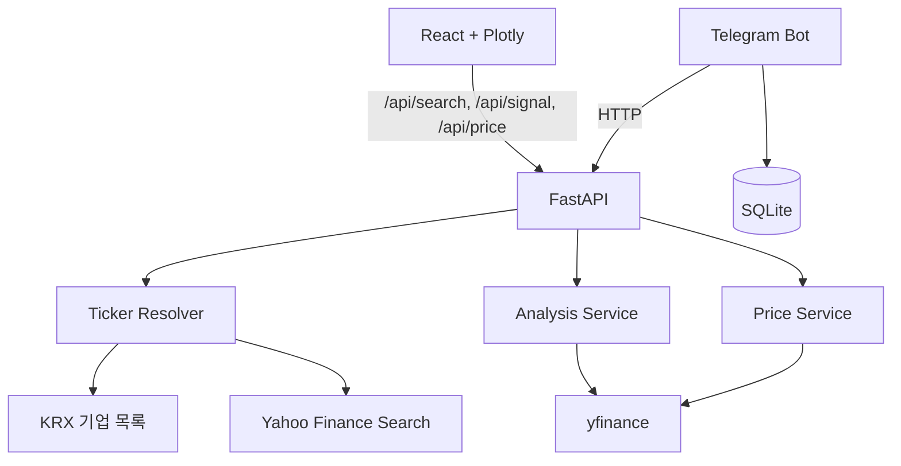

# 아키텍처와 설계 판단

## 구성

## 책임 분리

| 구성 요소 | 책임 |
| --- | --- |
| `frontend/` | 검색 자동완성, 분석·가격 대시보드, 오류 메시지 표시 |
| `backend/routers/` | HTTP 요청 검증, 응답 스키마, 외부 공급자 오류의 HTTP 상태 변환 |
| `backend/services/ticker_resolver.py` | 별칭·KRX·Yahoo를 조합한 종목 해석 |
| `backend/services/strategy.py` | 신호·포지션·수익률·성과 지표의 단일 구현 |
| `backend/services/analysis.py` | 시세 다운로드와 API 응답용 변환 |
| `telegram_bot/` | 조회 명령, 채팅별 별칭 관리, 응답 포맷 |

## 주요 설계 판단

### 이름과 티커를 분리해 해석

사용자는 `삼성전자`처럼 이름을, 데이터 공급자는 `005930.KS`처럼 티커를 요구합니다. 고정 별칭을 먼저 확인하고, 국내 종목은 KRX 목록, 영문 검색은 Yahoo 후보를 사용합니다. 다수 후보는 404와 함께 후보 목록을 반환해 클라이언트가 설명 가능한 오류를 보여줄 수 있게 했습니다.

### 외부 I/O가 API를 멈추지 않게 처리

KRX 목록은 동기 호출이므로 `asyncio.to_thread`로 이벤트 루프 밖에서 실행합니다. KRX와 Yahoo 검색에는 짧은 타임아웃과 1회 재시도를 둡니다. 실패한 KRX 목록은 캐시하지 않아 다음 요청에서 회복 기회를 남깁니다.

### 전략 계산을 한 곳에 둠

초기에는 웹 API와 정기 이메일 스크립트에 비슷한 계산이 각각 존재했습니다. 현재는 `strategy.py`가 공통 계산을 담당해 전략 규칙 수정 시 두 채널의 결과가 달라지는 위험을 줄였습니다.

### 조회 채널은 웹과 Telegram으로 분리

웹은 차트와 비교 정보를, Telegram은 빠른 텍스트 조회를 담당합니다. Telegram 별칭은 채팅 단위 SQLite에 저장하여 그룹 간 데이터를 분리합니다.

## 신뢰성 장치

- Pydantic 응답 모델로 API 형태를 고정
- `/api/health` 및 `/healthz` 헬스체크
- Docker 컨테이너 헬스체크와 재시작 정책
- 전략 시점·종목 해석·API 오류를 검증하는 pytest
- Pull Request에서 테스트, ESLint, 프로덕션 빌드를 실행하는 GitHub Actions

## 트레이드오프

공개 데이터 공급자를 사용해 구현 비용을 낮췄지만 데이터 품질 SLA는 제공하지 않습니다. 별도 데이터베이스·사용자 인증보다 종목 해석과 분석 결과 전달이라는 핵심 흐름을 먼저 완성하는 범위를 선택했습니다.
